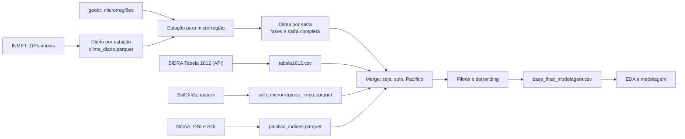

# Soja & Clima: mapa do projeto

Relação entre fatores climáticos e produção de soja no território brasileiro, em nível de microrregião.
Repositório: [https://github.com/vitorok03/projeto-pcd2](https://github.com/vitorok03/projeto-pcd2)

## Fluxo de dados

## Navegação

**1. Projeto**: [[Pergunta de pesquisa]] · [[Estrutura do repositório]] · [[O que mudou desde a versão anterior]] · [[Limitações conhecidas]] · [[O que ainda não foi verificado]]

**2. Fontes de dados**: [[INMET — estações automáticas]] · [[SIDRA — Tabela 1612]] · [[geobr — microrregiões]] · [[SoilGrids — solo]] · [[NOAA — ONI e SOI]]

**3. Pipeline**: [[Visão geral do pipeline]] · [[Etapa 01 — Processar clima]] · [[Etapa 02 — Processar soja]] · [[Etapa 03 — Processar solo]] · [[Etapa 04 — Processar Pacífico]] · [[main — base final de modelagem]]

**4. Código (`src/soja_clima`)**: [[Módulo inmet]] · [[Módulo clima]] · [[Módulo sidra]] · [[Módulo geo]] · [[Módulo agregacao]] · [[Módulo solo]] · [[Módulo pacifico]] · [[Módulo merge]] · [[Módulo qualidade]] · [[Testes]] · [[Pontos de atenção do código]]

**5. EDA**: [[EDA Clima]] · [[EDA Soja]] · [[EDA Solo]] · [[EDA Correlação e Anomalias]] · [[Feature Engineering e Clusters]] · [[Relatórios HTML de EDA]]

**6. Decisões**: [[D01 Microrregião em vez de UF]] · [[D02 Ano-safra de setembro a agosto]] · [[D03 Alvo é o rendimento]] · [[D04 Limiar de completude de 80 por cento]] · [[D05 Agregação temporal e espacial]] · [[D06 Distância máxima de 150 km]] · [[D07 Fases fenológicas]] · [[D08 Validação temporal e baselines]] · [[D09 Agregar cedo, em streaming]] · [[D10 Pacote src e notebooks]] · [[D11 Chave de junção nunca é só o nome]] · [[D12 Só microrregiões produtoras]] · [[D13 Solo como covariável estática]] · [[D14 Índices do Pacífico ONI e SOI]] · [[D15 Tendência tecnológica e detrending]] · [[D16 Filtros da base de modelagem]] · [[D17 Limites físicos dos sensores]] · [[D18 Município para microrregião pelo centróide]]

**7. Problemas resolvidos**: [[P01 Formato do INMET muda entre anos]] · [[P02 Estação da Antártica]] · [[P03 Sensor travado]] · [[P04 Colisão de nome na chave de junção]] · [[P05 glob duplica arquivos no Windows]] · [[P06 Rodapé do SIDRA e skipfooter]] · [[P07 Denominador de 558 microrregiões]] · [[P08 Coordenadas divergentes e índice duplicado]] · [[P09 Avisos e mudanças do pandas]] · [[P10 Google Drive lento no Colab]] · [[P11 Soma entre estações multiplicava a chuva]] · [[P12 Código da microrregião como float ou texto]]

**8. Questões em aberto**: [[Q01 Microrregiões produtoras fora da base final]] · [[Q02 Arquivos de 2005 com formato diferente]] · [[Q03 Ponderação por completude foi mantida]] · [[Q04 Recorte temporal inicial]] · [[Q05 Defasagem dos índices ONI e SOI]] · [[Q06 Método de detrending]] · [[Q07 Modelos e resultados]] · [[Q08 Cobertura de testes]]

**9. Glossário**: [[Ano-safra]] · [[GDD]] · [[Completude]] · [[Microrregião]] · [[Efeito fixo]] · [[Persistência (baseline)]] · [[Point-in-polygon]] · [[CRS]] · [[ENSO]] · [[ONI]] · [[SOI]] · [[Estatística zonal]] · [[Detrending]] · [[Anomalia climática]] · [[Chave de junção]]

**Painel**: [[Painel]] · **Como usar**: [[LEIA-ME]]
